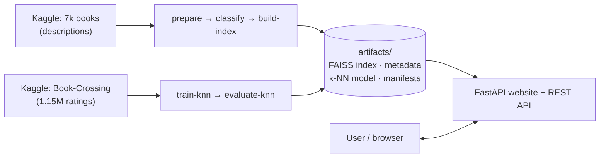
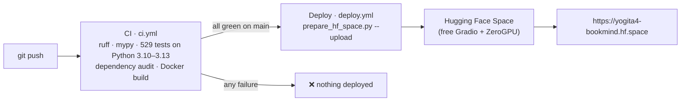

# BookMind Pro — Hybrid Book Recommender System

[](https://github.com/YogitaPatil5/hybrid_book_recommender/actions/workflows/ci.yml)
[](https://github.com/YogitaPatil5/hybrid_book_recommender/actions/workflows/deploy.yml)

A production-grade book search and recommendation web app. Users can search by **title, genre or a
free-text description** ("a slow-burn mystery set in winter"), browse a genre, and get
**"books like this one"** recommendations.

| | |
|---|---|
| 🌐 **Live app** | **https://yogita4-bookmind.hf.space** (free hosting; first visit after a quiet period takes ~1 min to wake up) |
| 💻 **Source code** | https://github.com/YogitaPatil5/hybrid_book_recommender |
| 📖 **Learner's guide** | [`docs/EXPLAINER.html`](docs/EXPLAINER.html) — every concept and function explained (open in a browser) |

**Free and open source** — no OpenAI or any paid API key. After the first download it runs fully offline.
**529 automated tests · ~99% coverage · strict type checking · Docker · CI/CD to a live URL.**

---

## Contents
1. [What it does and how it works](#1-what-it-does-and-how-it-works)
2. [Tech stack](#2-tech-stack)
3. [Setup — step by step](#3-setup--step-by-step)
4. [Using the app](#4-using-the-app)
5. [Pipeline commands](#5-pipeline-commands)
6. [Evaluation results](#6-evaluation-results)
7. [Features](#7-features)
8. [REST API](#8-rest-api)
9. [Project structure](#9-project-structure)
10. [Configuration](#10-configuration)
11. [Quality assurance & testing](#11-quality-assurance--testing)
12. [CI/CD and live deployment](#12-cicd-and-live-deployment)
13. [Other ways to run or share it](#13-other-ways-to-run-or-share-it)
14. [Production readiness & limitations](#14-production-readiness--limitations)
15. [Troubleshooting](#15-troubleshooting)
16. [Documentation index](#16-documentation-index)

---

## 1. What it does and how it works

| Technique | Used for | When it runs |
|---|---|---|
| **Sentence embeddings + FAISS** (`all-MiniLM-L6-v2`, 384 dims) | Semantic search (meaning, not keywords) and content-based "similar books" | Every search |
| **Collaborative filtering** (item-item k-NN, cosine) | "Readers who liked X also liked Y", trained on ~1.15M Book-Crossing ratings | Every recommendation for a title it knows |
| **Local LLM** (Ollama `llama3.2`) — optional | Tags each book with one genre from a fixed list of 20 | Once, offline, while building |



1. **Offline pipeline (run once):** cleans the data, tags genres, turns every book into a vector
   (FAISS index) and trains the collaborative-filtering model. Results are saved in `artifacts/`
   with SHA-256 checksums.
2. **Web app (always running):** loads both engines at startup and answers searches in milliseconds.
   **Hybrid recommendation:** "similar books" uses collaborative filtering when the title is in the
   ratings data (a behavioural signal) and falls back to semantic similarity otherwise, so every book
   gets recommendations — including brand-new ones with no ratings (no cold-start problem).

**Data**

| Dataset (Kaggle) | Used for | After cleaning |
|---|---|---|
| `dylanjcastillo/7k-books-with-metadata` | Semantic search (titles, authors, descriptions, covers) | 6,323 books, 20 genres |
| `ra4u12/bookrecommendation` (Book-Crossing) | Collaborative filtering | 637 books × 806 readers, 52,615 interactions from 1.15M ratings |

Architecture diagrams: [`docs/ARCHITECTURE.md`](docs/ARCHITECTURE.md).

---

## 2. Tech stack

| Layer | Technology | Why |
|---|---|---|
| Web framework | **FastAPI** + Jinja2 templates | Validation and OpenAPI docs from type hints; dependency injection; standard for ML serving |
| Server | **uvicorn** (dev) · **gunicorn + uvicorn workers** (prod) | ASGI server; supervised worker processes |
| Config & schemas | **Pydantic v2**, pydantic-settings | Invalid config fails at startup; responses are a typed contract |
| Embeddings | **Sentence-Transformers** `all-MiniLM-L6-v2` | Small (~80 MB), fast on CPU, free, offline |
| Vector search | **FAISS** `IndexFlatIP` | Exact cosine search in ~1 ms; genre filtering inside the index |
| Collaborative filtering | **scikit-learn** `NearestNeighbors` (cosine) on a sparse matrix | Simple, explainable item-item k-NN |
| Data | **pandas**, **pyarrow** (parquet) | Typed, compressed, fast-loading metadata |
| Genre tagging | **Ollama** `llama3.2` (optional) | Local, free LLM — used once offline |
| Operations | Prometheus client, `limits` (rate limiting), structured logging | Metrics, abuse protection, traceable logs |
| Quality | pytest, pytest-cov, ruff, mypy (strict), pre-commit | Tests, lint, type safety on every commit |
| Delivery | Docker, docker-compose, **GitHub Actions**, **Hugging Face Spaces** | Reproducible builds, CI/CD, free public hosting |

---

## 3. Setup — step by step

> Commands are shown for **Windows Command Prompt** (incl. the VS Code terminal) and
> **macOS / Linux**. Run every command from the project folder (the one with `pyproject.toml`).

### Step 0 — Prerequisites

| Need | Check | Notes |
|---|---|---|
| Python **3.10 – 3.13** | `python --version` (Windows) · `python3 --version` (mac/Linux) | Install from python.org; on Windows tick "Add python.exe to PATH" |
| Git *(to clone)* | `git --version` | https://git-scm.com — or download the repository as a ZIP from GitHub |
| Internet (first run only) | — | To install packages and download the model (~80 MB) |
| ~3 GB free disk | — | Mostly PyTorch + the virtual environment |
| Ollama — *optional* | `ollama --version` | Only for LLM genre tagging; the keyword tagger works without it |

### Step 1 — Get the project and open a terminal

```cmd
git clone https://github.com/YogitaPatil5/hybrid_book_recommender.git
cd hybrid_book_recommender
```
(Or **Code → Download ZIP** on GitHub, unzip, and open a terminal in that folder.
VS Code: **File → Open Folder**, then **Terminal → New Terminal**.)

The repository already contains the built `artifacts/` (search index and k-NN model), so you can run
the app **without** downloading the datasets or rebuilding (Steps 5–7 are optional).

### Step 2 — Create and activate a virtual environment

| | Windows (Command Prompt) | Windows (PowerShell) | macOS / Linux |
|---|---|---|---|
| Create | `python -m venv .venv` | `python -m venv .venv` | `python3 -m venv .venv` |
| Activate | `.venv\Scripts\activate` | `.\.venv\Scripts\Activate.ps1` | `source .venv/bin/activate` |

Your prompt now starts with `(.venv)`. **Activate again every time you open a new terminal.**
(PowerShell "running scripts is disabled"? Run `Set-ExecutionPolicy -Scope CurrentUser RemoteSigned` once.)

### Step 3 — Install dependencies

```cmd
python -m pip install --upgrade pip
python -m pip install --index-url https://download.pytorch.org/whl/cpu torch
python -m pip install -r requirements-dev.txt
python -m pip install -e . --no-deps
```
- Line 2 installs the **CPU-only** PyTorch (≈ 200 MB instead of ≈ 2 GB of GPU libraries).
- `requirements-dev.txt` = app + pipeline + test tools. For a server, `requirements.txt` is enough.
- Line 4 installs the project itself so `bookmind` can be imported.

Then create your settings file (defaults work as-is):

| Windows | macOS / Linux |
|---|---|
| `copy .env.example .env` | `cp .env.example .env` |

> 💡 **Why `python -m …` everywhere?** It works even on locked-down PCs where security policies
> (e.g. Windows Device Guard) block `.exe` launchers such as `pytest.exe` or `pip.exe`.
>
> **Shortcut:** `powershell -ExecutionPolicy Bypass -File scripts\setup.ps1` (Windows) or
> `./scripts/setup.sh` (mac/Linux) runs Steps 2–3 for you.

### Step 4 — Verify the installation

```cmd
python -m pytest
```
✅ Expected: **`529 passed`**. The tests run offline with small built-in sample data.

### Step 5 — (Optional) download the datasets

Only needed to rebuild the index or retrain the model.
```cmd
python -m bookmind.pipeline.cli download
```
Creates `data/books_raw.csv` (7k books) and `data/bx/BX-Books.csv`, `BX-Book-Ratings.csv`,
`BX-Users.csv` (Book-Crossing). Public datasets usually download without login; if Kaggle asks for
credentials, run `python -c "import kagglehub; kagglehub.login()"` once.

### Step 6 — (Optional) rebuild the search index and models

**Without Ollama (~2 minutes):**
```cmd
python -m bookmind.pipeline.cli all --classifier keyword
```
**With LLM genre tagging (better genres, slower):**
```cmd
ollama pull llama3.2
python -m bookmind.pipeline.cli all
```
`all` runs **prepare → classify → build-index → train-knn** and writes `artifacts/`:
`book_index.faiss`, `book_meta.parquet`, `manifest.json`, four `.pkl` files and `knn_manifest.json`.

### Step 7 — (Optional) evaluate the recommender

```cmd
python -m bookmind.pipeline.cli evaluate-knn --compare-modes
```
Prints Hit-Rate@5 and catalogue coverage for each rating encoding and saves `artifacts/knn_eval_*.json`
(see [Evaluation results](#6-evaluation-results)).

### Step 8 — Run the app (one command)

| Windows | macOS / Linux | Any OS (inside the venv) |
|---|---|---|
| `run.bat` *(or double-click it)* | `./run.sh` | `python -m bookmind --open` |

The browser opens automatically and the terminal prints the address, e.g.
`Starting BookMind — open http://localhost:8000`.
- **No environment variables needed** — the model loads from the local cache, fully offline.
- **Port already in use?** It automatically picks the next free port (8001, 8002 …) and prints it.
- `run.bat` / `run.sh` also build the index automatically if `artifacts/` is missing.
- Stop with **Ctrl+C**. Next time, just run `run.bat` again.

### Step 9 — Full check (before a demo or submission)

Use a **second terminal** for the `curl` commands (keep the app running in the first) and replace
`8000` with the port the app printed.

| # | Command | ✅ Expected |
|---|---|---|
| 1 | `python -m pytest` | `529 passed` |
| 2 | `python -m ruff check src tests scripts deploy` | `All checks passed!` |
| 3 | `python -m mypy` | `Success: no issues found` |
| 4 | `dir artifacts` *(mac/Linux: `ls`)* | `book_index.faiss`, `manifest.json`, 4 `.pkl`, `knn_manifest.json` |
| 5 | `run.bat` | Browser opens; terminal prints `open http://localhost:PORT` |
| 6 | `curl http://localhost:8000/health/ready` | `"status":"ready"`, semantic + knn ready |
| 7 | `curl "http://localhost:8000/api/v1/search?q=a+story+about+forgiveness&top_k=3"` | 3 books with scores |
| 8 | `curl "http://localhost:8000/api/v1/search?genre=Fantasy&top_k=3"` | Popular Fantasy books (no query needed) |
| 9 | `curl "http://localhost:8000/api/v1/autocomplete?q="` | `"mode":"popular"` + titles |
| 10 | `curl http://localhost:8000/api/v1/stats` | Book counts and model info |
| 11 | `start docs\EXPLAINER.html` *(mac: `open`, Linux: `xdg-open`)* | Learner's guide opens |

---

## 4. Using the app

| Page / URL | What you can do |
|---|---|
| `/` Home | Book counts, trending & popular books |
| `/search` | Click the empty box → **Popular books** dropdown; type a title or a *description* ("a story about forgiveness"); or leave it empty and pick a **genre** to browse |
| `/recommend` | Pick a book you liked → **"Readers who rated this book also loved these"** (k-NN) or **"Books with the most similar themes and content"** (semantic fallback) |
| `/about` | How the system works |
| 🌙 / ☀️ button | Dark / light theme (follows your OS, remembered) |
| `/docs` | Interactive API documentation |
| `/health/ready` | Engine status (`ready` / `degraded` / `unavailable`) |
| `/demo` *(live Space only)* | A Gradio version of the screens |

---

## 5. Pipeline commands

Run as `python -m bookmind.pipeline.cli <command>`.

| Command | What it does |
|---|---|
| `download [--only semantic\|knn] [--force]` | Fetch both Kaggle datasets with kagglehub |
| `prepare` | Clean & validate the 7k-books CSV (HTML, duplicates, invalid values, stable `book_id`) |
| `classify [--backend ollama\|keyword]` | One genre per book; resumable; retries + keyword fallback |
| `build-index [--backend sentence-transformers\|hashing]` | Embeddings → FAISS index + manifest with checksums |
| `train-knn [--mode binary\|weighted\|explicit] [--evaluate]` | Collaborative-filtering model; records library versions for deployment |
| `evaluate-knn [--k 5] [--compare-modes]` | Hit-Rate@K vs popularity baseline + coverage → `artifacts/knn_eval_*.json` |
| `all [--classifier keyword] [--skip-knn]` | prepare → classify → build-index → train-knn |

App launcher options: `python -m bookmind [--port 9000] [--host 127.0.0.1] [--open] [--reload]`.

---

## 6. Evaluation results

`evaluate-knn` holds out 20% of readers **before training** (no data leakage). For each held-out
reader it checks whether the model's top-5 neighbours of one book they read contain **another** book
they read (**Hit-Rate@5**), and compares with a **popularity baseline** (always recommend the 5
most-read books). **Catalogue coverage** = share of all books that ever get recommended.

Measured on the full Book-Crossing dataset (1,149,725 valid ratings → 637 books × 806 readers):

| Model | Hit-Rate@5 | Catalogue coverage |
|---|---|---|
| k-NN, `binary` encoding (default) | **0.645** | **80.7%** |
| k-NN, `weighted` encoding | 0.571 | 90.4% |
| Popularity baseline | 0.688 | 0.9% |

On Book-Crossing a few bestsellers are read by almost everyone, so "always recommend the top 5"
scores a high hit-rate — but it shows the **same 5 books to every user** (0.9% coverage) and cannot
answer "books similar to *this one*". k-NN reaches 64.5% while covering 80.7% of the catalogue.
`binary` is the default because it beat the other encodings (`explicit` is skipped at default
thresholds: without the implicit interactions too few readers remain).

---

## 7. Features

| Area | What you get |
|---|---|
| UI | Light & dark themes (follows the OS, one-click toggle, remembered, no flash on load), slate + indigo palette (all text colours meet WCAG-AA contrast ≥ 4.5:1 in both themes), responsive, keyboard-accessible |
| Discovery | Empty search box → "Popular books" dropdown (genre-aware); browse a genre without typing; type-ahead from the first letter |
| Recommendation | Hybrid: collaborative filtering → semantic fallback; exact genre filtering inside FAISS; duplicate editions merged |
| API | Versioned REST API (`/api/v1`), OpenAPI docs at `/docs`, one consistent error format |
| Validation | Pydantic settings & schemas; query sanitising (length, control chars, unicode); genre whitelist; `top_k` bounds; dataset validation in every pipeline step |
| Error handling | Typed exceptions with stable error codes; JSON for API clients, friendly HTML for browsers; internals never leaked |
| Logging | Structured logs (text in dev, JSON in prod), `X-Request-ID` on every request, rotating log files |
| Observability | `/health/live`, `/health/ready` (per-component), Prometheus `/metrics` |
| Security | Content-Security-Policy (no inline scripts), HSTS in production, frame-ancestors control, trusted hosts, CORS allow-list, rate limiting, SHA-256 checksums on all model files |
| Resilience | Degraded mode instead of crashing; Ollama retries + fallback; atomic writes; resumable jobs; offline-first model loading; automatic free-port selection in development |
| Quality | 529 tests (unit, integration, end-to-end), ~99% coverage, ruff, strict mypy, pre-commit |
| Delivery | GitHub Actions CI on 4 Python versions; deploy to Hugging Face only after green CI; multi-stage non-root Dockerfile; gunicorn + uvicorn workers; docker-compose with Redis |

---

## 8. REST API

| Method | Path | Description |
|---|---|---|
| GET | `/api/v1/search?q=&genre=&top_k=` | Semantic search. `q` optional when `genre` is given (→ most popular in that genre) |
| GET | `/api/v1/books/similar?title=&top_k=&engine=auto\|semantic\|knn` | Similar books (hybrid) |
| GET | `/api/v1/autocomplete?q=&limit=&genre=` | Title suggestions; empty `q` → popular titles (`"mode":"popular"`) |
| GET | `/api/v1/genres` | Genre list |
| GET | `/api/v1/stats` | Catalogue and model metadata |
| GET | `/health/live` · `/health/ready` · `/metrics` | Liveness, readiness, Prometheus metrics |

Every error uses one format:
```json
{"error": {"code": "book_not_found", "message": "...", "request_id": "3f9c…", "details": {"suggestions": []}}}
```

---

## 9. Project structure

```
hybrid_book_recommender/
├── src/bookmind/
│   ├── __main__.py            # `python -m bookmind` launcher (port fallback, --open)
│   ├── main.py                # FastAPI app factory: middleware, routers, startup
│   ├── core/                  # config.py (settings), exceptions.py, logging.py
│   ├── middleware/            # request_context.py (request id, logs, metrics, security headers), rate_limit.py
│   ├── api/                   # v1/routes.py (JSON API), health.py, errors.py, deps.py
│   ├── web/routes.py          # HTML pages
│   ├── schemas/               # Pydantic response models (the API contract)
│   ├── services/              # semantic_search, knn_recommender, recommendation (hybrid),
│   │                          # registry, artifacts, validation, buy_links
│   ├── ml/embedder.py         # MiniLM / hashing encoders + LRU cache
│   ├── pipeline/              # cli, download, prepare, classify, build_index, knn, io
│   ├── templates/             # Jinja2 pages
│   └── static/                # css/style.css (themes), js/theme.js, main.js, autocomplete.js, img/
├── tests/                     # unit/ (17 files), integration/ (5 files), fixtures/ — 529 tests
├── artifacts/                 # built search index + k-NN model (committed; deployed to the Space)
├── docs/                      # EXPLAINER.html, ARCHITECTURE.md, REVIEW_AND_CHANGES.md,
│                              # SUBMISSION_GUIDE.md, DEPLOY_HUGGINGFACE.md, ROADMAP.md
├── deploy/gradio/             # app.py (Space entry point: full website + Gradio at /demo), Space README
├── deploy/huggingface/        # Dockerfile + README for a (paid) Docker Space
├── scripts/                   # setup.ps1, setup.sh, prepare_hf_space.py (builds/uploads the Space)
├── .github/workflows/         # ci.yml (lint, types, tests, audit, Docker) · deploy.yml (→ Space after green CI)
├── run.bat · run.sh           # one-command launchers
├── requirements.txt           # runtime
├── requirements-pipeline.txt  # + ollama, tqdm, kagglehub
├── requirements-dev.txt       # + pytest, ruff, mypy, pre-commit
├── pyproject.toml · .env.example · Makefile · .pre-commit-config.yaml
└── Dockerfile · docker-compose.yml · gunicorn.conf.py
```
Not committed (generated locally): `.venv/`, `data/`, `logs/`, `hf_space/`, `.env`.

---

## 10. Configuration

All settings are environment variables prefixed `BOOKMIND_`, set in `.env` (see `.env.example`).
Invalid values stop the app at startup with a clear message.

| Variable | Default | Meaning |
|---|---|---|
| `BOOKMIND_ENV` | `development` | `production` hides `/docs` (unless `ENABLE_DOCS`), enables HSTS, forbids debug, keeps the exact port |
| `BOOKMIND_DEBUG` | `false` | Never allowed in production |
| `BOOKMIND_HOST` / `BOOKMIND_PORT` | `0.0.0.0` / `8000` | Bind address (next free port is used automatically in development) |
| `BOOKMIND_WORKERS` | `2` | gunicorn worker processes |
| `BOOKMIND_DATA_DIR` / `BOOKMIND_ARTIFACTS_DIR` / `BOOKMIND_LOG_DIR` | `data` / `artifacts` / `logs` | Folders |
| `BOOKMIND_LOG_LEVEL` / `BOOKMIND_LOG_JSON` / `BOOKMIND_LOG_TO_FILE` | `INFO` / `false` / `true` | Logging |
| `BOOKMIND_EMBEDDING_BACKEND` | `sentence-transformers` | `hashing` = offline test encoder (lower quality) |
| `BOOKMIND_EMBEDDING_MODEL` | `all-MiniLM-L6-v2` | Sentence-Transformers model |
| `BOOKMIND_EMBEDDING_DEVICE` | `cpu` | `cpu` · `cuda` · `mps` |
| `BOOKMIND_EMBEDDING_CACHE_SIZE` | `2048` | LRU cache of encoded queries |
| `BOOKMIND_ENABLE_KNN` | `true` | Load the collaborative-filtering model if present |
| `BOOKMIND_ENABLE_DOCS` | `false` | Keep `/docs` visible in production (on for the live demo) |
| `BOOKMIND_MAX_QUERY_LENGTH` | `300` | Characters |
| `BOOKMIND_MAX_TOP_K` / `BOOKMIND_DEFAULT_TOP_K` | `50` / `12` | Result limits |
| `BOOKMIND_RATE_LIMIT` / `BOOKMIND_RATE_LIMIT_ENABLED` | `60/minute` / `true` | Per client IP |
| `BOOKMIND_RATE_LIMIT_STORAGE_URI` | `memory://` | `redis://host:6379` to share limits across workers |
| `BOOKMIND_CORS_ORIGINS` / `BOOKMIND_TRUSTED_HOSTS` | `["http://localhost:8000"]` / `["*"]` | Cross-origin and Host-header allow-lists |
| `BOOKMIND_FRAME_ANCESTORS` | `[]` | Sites allowed to embed the pages (live Space: `["https://huggingface.co"]`) |
| `BOOKMIND_MOUNTED_APP_PATHS` | `[]` | Mounted sub-apps with their own scripts (live Space: `["/demo"]`) |
| `BOOKMIND_OLLAMA_MODEL` / `BOOKMIND_OLLAMA_HOST` | `llama3.2` / `http://localhost:11434` | Optional LLM genre tagging |

---

## 11. Quality assurance & testing

Quality is checked automatically in layers — locally and on every push:

| Layer | What it checks | How |
|---|---|---|
| Unit tests | Each function on its own (validation, parsing, encoders, manifests, k-NN encodings, packaging) | 17 test files |
| Integration tests | API, website, middleware, error handling, rate limiting, security headers, hybrid fallback, degraded mode | 5 test files with FastAPI `TestClient` |
| End-to-end | Pipeline builds real FAISS/k-NN artifacts → app loads them → search works | `tests/integration/test_end_to_end.py` |
| Coverage | ~99% of the code runs under test; CI fails below 85% | pytest-cov |
| Static analysis | Style, common bugs, strict typing | ruff, ruff format, mypy (strict) |
| Model evaluation | Recommendations are good, not just running | Hit-Rate@5 + coverage vs a baseline, no leakage |
| Data validation | Bad data can't enter | Cleaning reports; SHA-256 checksums; manifests |
| CI | All of the above on Python 3.10–3.13, dependency audit, Docker build | `.github/workflows/ci.yml` |
| Release gate | Broken code never reaches users | Deploy runs only after green CI |
| Production monitoring | Problems are visible after release | `/health/*`, `/metrics`, structured logs with request IDs |

```cmd
python -m pytest                                   # 529 tests
python -m pytest --cov --cov-report=html           # coverage → htmlcov/index.html
python -m ruff check src tests scripts deploy      # lint
python -m ruff format --check src tests scripts deploy
python -m mypy                                     # strict type checking
```
The tests run offline: a hashing encoder stands in for MiniLM and small generated fixtures stand in
for the Kaggle files — FAISS, scikit-learn, the API and the pipeline run for real.

---

## 12. CI/CD and live deployment



- **Every push** runs CI. **Deploy** starts only when CI passes on `main`, builds the Space package
  and uploads it with a token stored as an encrypted GitHub secret (`HF_TOKEN`; Space name in the
  `HF_SPACE` variable).
- **Why a Gradio Space?** Free Hugging Face accounts can no longer run Docker Spaces; a Gradio Space
  runs `python app.py`. [`deploy/gradio/app.py`](deploy/gradio/app.py) serves the **complete FastAPI
  website** on port 7860 and mounts a Gradio screen at `/demo`, sends ZeroGPU's startup report, keeps
  the model on CPU and turns off Gradio's server-side rendering (which would take the port).
- **Reproducible model loading:** `train-knn` records the numpy/pandas/scipy/scikit-learn versions
  in `knn_manifest.json`; the Space installs exactly those, so the pickled model loads identically.
- **Release workflow from now on:**
  ```cmd
  python -m pytest
  git add .
  git commit -m "describe your change"
  git push
  ```
  → tests run on GitHub → if green, the live site updates automatically (~15 minutes end to end).

Full guide, including first-time setup and every error we met: [`docs/DEPLOY_HUGGINGFACE.md`](docs/DEPLOY_HUGGINGFACE.md).

---

## 13. Other ways to run or share it

**Docker (web app + Redis):**
```bash
docker compose up --build -d
docker compose --profile pipeline run --rm pipeline all --classifier keyword   # if artifacts/ is empty
docker compose restart web
```
**Linux server without Docker:** `gunicorn -c gunicorn.conf.py "bookmind.main:create_app()"`

| Share with | How | Laptop on? |
|---|---|---|
| People on the same Wi-Fi | `ipconfig` → share `http://<your-IPv4>:8000` (allow Python in the Windows Firewall pop-up for *Private networks*) | Yes |
| Anyone, temporary link | `cloudflared tunnel --url http://localhost:8000` → share the `https://….trycloudflare.com` link | Yes |
| Anyone, permanent link | The live Space (section 12) | **No** |

---

## 14. Production readiness & limitations

**Covered:** layered architecture, validation at every boundary, typed errors, structured logs with
request IDs, health/readiness probes, Prometheus metrics, rate limiting, security headers, checksummed
and version-pinned model artifacts, degraded mode, ~99% test coverage, strict typing, Docker, and
CI/CD with a release gate.

**What a company would add before serving real customers** (see [`docs/ROADMAP.md`](docs/ROADMAP.md)):
a staging environment and one-click rollback; dashboards and alerting on the metrics; load testing with
latency targets; paid hosting with an uptime guarantee (the free Space sleeps when idle); monitoring of
recommendation quality and scheduled retraining; branch protection with pull-request reviews;
browser UI tests and container scanning in CI; self-hosted fonts/icons instead of CDNs.

**Known limitations:** collaborative filtering covers only the 637 Book-Crossing titles (the two
datasets don't share IDs); genres come from a keyword tagger unless Ollama is used; covers depend on
external image URLs.

---

## 15. Troubleshooting

| Problem | Fix |
|---|---|
| `'xyz.exe' was blocked by … Device Guard policy` | Use the `python -m …` form (e.g. `python -m pytest`) |
| `No module named bookmind` | Activate the venv (Step 2) and run Step 3 line 4 |
| `'python' is not recognized` | Use `py` instead of `python`, or reinstall Python with "Add to PATH" |
| `Connection was reset` on port 8000 | Another program owns 8000 — use the port printed by `run.bat`, or set `BOOKMIND_PORT=8001` in `.env` |
| Kaggle download fails | Check internet; run `python -c "import kagglehub; kagglehub.login()"` once |
| `Cannot reach the Ollama server` | Start Ollama, or use `--classifier keyword` |
| Page shows "Search index not built" | `python -m bookmind.pipeline.cli all --classifier keyword`, then restart |
| `/health/ready` shows `knn` not ready | Check `data/bx/` has the BX files, then `python -m bookmind.pipeline.cli train-knn` |
| Old look after an update | Hard refresh the browser (**Ctrl+F5**) |
| CI or Deploy red on GitHub | Open the failed step and read the last lines; see the troubleshooting table in `docs/DEPLOY_HUGGINGFACE.md` |
| Live Space shows "Sleeping" | Open the link and wait ~1 minute |

---

## 16. Documentation index

| Document | Contents |
|---|---|
| [`docs/EXPLAINER.html`](docs/EXPLAINER.html) | Learner's guide: concepts in depth, every module and function (what/why/how), production practices, CI/CD, a 10-stage rebuild plan, quiz and glossary |
| [`docs/ARCHITECTURE.md`](docs/ARCHITECTURE.md) | Diagrams: system, pipelines, request lifecycle, discovery, startup, layers, CI/CD, live deployment; module map |
| [`docs/REVIEW_AND_CHANGES.md`](docs/REVIEW_AND_CHANGES.md) | Review of the original code, every problem found and how it was fixed, deployment lessons |
| [`docs/SUBMISSION_GUIDE.md`](docs/SUBMISSION_GUIDE.md) | Submission checklist, 6-minute demo script, viva questions and answers |
| [`docs/DEPLOY_HUGGINGFACE.md`](docs/DEPLOY_HUGGINGFACE.md) | Putting it online: CI/CD route, manual route, troubleshooting |
| [`docs/ROADMAP.md`](docs/ROADMAP.md) | Next steps: bigger and live data, production hardening, product features |

**Notes**
- k-NN files are scikit-learn pickles: checksum-verified before loading, and the app warns if the
  scikit-learn version differs from training — retrain with `train-knn` after upgrading.
- Buy links are retailer **search** URLs (Amazon, Flipkart, Google Books), never guessed product IDs.

*Author: Yogita Patil — [github.com/YogitaPatil5](https://github.com/YogitaPatil5)*
