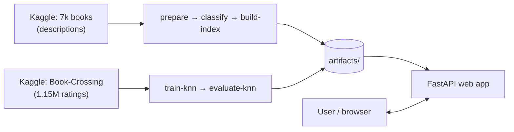

# BookMind Pro — Hybrid Book Recommender System

A production-grade book search and recommendation web app. Users can search by **title, author,
genre or a free-text description** ("a slow-burn mystery set in winter"), browse a genre, and get
**"books like this one"** recommendations.

| Technique | Used for | When it runs |
|---|---|---|
| **Sentence embeddings + FAISS** (`all-MiniLM-L6-v2`) | Semantic search (meaning, not keywords) and content-based "similar books" | Every search |
| **Collaborative filtering** (item-item k-NN, cosine) | "Readers who liked X also liked Y", trained on ~1.15M Book-Crossing ratings | Every recommendation for a title it knows |
| **Local LLM** (Ollama `llama3.2`) — optional | Tags each book with one genre from a fixed list of 20 | Once, offline, while building |

**Free and local** — no OpenAI or any paid API key. After the first download it runs fully offline.

Built with FastAPI · Pydantic · Sentence-Transformers · FAISS · scikit-learn · pandas.
**529 automated tests · ~99% coverage · strict type checking · Docker · CI.**

📚 Documentation:
[`docs/EXPLAINER.html`](docs/EXPLAINER.html) (learn & rebuild the project — open in a browser) ·
[`docs/ARCHITECTURE.md`](docs/ARCHITECTURE.md) (diagrams) ·
[`docs/REVIEW_AND_CHANGES.md`](docs/REVIEW_AND_CHANGES.md) (problems found → fixes) ·
[`docs/SUBMISSION_GUIDE.md`](docs/SUBMISSION_GUIDE.md) (demo script & viva Q&A) ·
[`docs/DEPLOY_HUGGINGFACE.md`](docs/DEPLOY_HUGGINGFACE.md) (put it online for free) ·
[`docs/ROADMAP.md`](docs/ROADMAP.md) (bigger & live data)

---

## How it works



1. **Offline pipeline (run once):** cleans the data, tags genres, turns every book into a vector
   (FAISS index) and trains the collaborative-filtering model. Results are saved in `artifacts/`.
2. **Web app (always running):** loads both engines at startup and answers searches in milliseconds.
   "Similar books" uses collaborative filtering when the title is in the ratings data and falls back
   to semantic similarity otherwise.

---

# Setup — step by step

> Commands are shown for **Windows Command Prompt** (incl. the VS Code terminal) and
> **macOS / Linux**. Run every command from the project folder (the one with `pyproject.toml`).

## Step 0 — Prerequisites

| Need | Check | Notes |
|---|---|---|
| Python **3.10 – 3.13** | `python --version` (Windows) · `python3 --version` (mac/Linux) | Install from python.org; on Windows tick "Add python.exe to PATH" |
| Internet (first run only) | — | To install packages and download the datasets (~45 MB) and model (~80 MB) |
| ~3 GB free disk | — | Mostly PyTorch + the virtual environment |
| Ollama — *optional* | `ollama --version` | Only for LLM genre tagging; the keyword tagger works without it |

## Step 1 — Get the project and open a terminal

Unzip / clone the project, then open a terminal in the `bookmind_pro` folder
(VS Code: **File → Open Folder**, then **Terminal → New Terminal**).

```cmd
cd path\to\bookmind_pro
```

## Step 2 — Create and activate a virtual environment

| | Windows (Command Prompt) | Windows (PowerShell) | macOS / Linux |
|---|---|---|---|
| Create | `python -m venv .venv` | `python -m venv .venv` | `python3 -m venv .venv` |
| Activate | `.venv\Scripts\activate` | `.\.venv\Scripts\Activate.ps1` | `source .venv/bin/activate` |

Your prompt now starts with `(.venv)`. **Activate again every time you open a new terminal.**
(PowerShell "running scripts is disabled"? Run `Set-ExecutionPolicy -Scope CurrentUser RemoteSigned` once.)

## Step 3 — Install dependencies

```cmd
python -m pip install --upgrade pip
python -m pip install --index-url https://download.pytorch.org/whl/cpu torch
python -m pip install -r requirements-dev.txt
python -m pip install -e . --no-deps
```
- Line 2 installs the **CPU-only** PyTorch (≈ 200 MB instead of ≈ 2 GB of GPU libraries).
- `requirements-dev.txt` = app + pipeline + test tools. For a server, `requirements.txt` is enough.
- Line 4 installs the project itself so `bookmind` can be imported and `bookmind-pipeline` exists.

Then create your settings file (defaults work as-is):

| Windows | macOS / Linux |
|---|---|
| `copy .env.example .env` | `cp .env.example .env` |

> 💡 **Why `python -m …` everywhere?** It works even on locked-down PCs where security policies
> (e.g. Windows Device Guard) block `.exe` launchers such as `pytest.exe` or `pip.exe`.
>
> **Shortcut:** `powershell -ExecutionPolicy Bypass -File scripts\setup.ps1` (Windows) or
> `./scripts/setup.sh` (mac/Linux) runs Steps 2–3 for you.

## Step 4 — Verify the installation

```cmd
python -m pytest
```
✅ Expected: **`529 passed`**. The tests run offline with small built-in sample data.

## Step 5 — Download the datasets (free, via kagglehub)

```cmd
python -m bookmind.pipeline.cli download
```
Creates:
- `data/books_raw.csv` — 7k books with descriptions (for semantic search)
- `data/bx/BX-Books.csv`, `BX-Book-Ratings.csv`, `BX-Users.csv` — Book-Crossing ratings (for k-NN)

Public datasets usually download without login. If Kaggle asks for credentials, create a free
account and run `python -c "import kagglehub; kagglehub.login()"` once.

## Step 6 — Build the search index and models

**Option A — without Ollama (recommended to start, ~2 minutes):**
```cmd
python -m bookmind.pipeline.cli all --classifier keyword
```
**Option B — with LLM genre tagging (better genres, slower):**
```cmd
ollama pull llama3.2
python -m bookmind.pipeline.cli all
```
`all` runs **prepare → classify → build-index → train-knn**. The first run downloads the embedding
model once (~80 MB). Afterwards `artifacts/` contains `book_index.faiss`, `book_meta.parquet`,
`manifest.json`, four `.pkl` files and `knn_manifest.json`.

## Step 7 — Evaluate the recommender (optional, for your report)

```cmd
python -m bookmind.pipeline.cli evaluate-knn --compare-modes
```
Prints Hit-Rate@5 and catalogue coverage for each rating encoding and saves
`artifacts/knn_eval_*.json`. See [Evaluation](#evaluation).

## Step 8 — Run the app (one command)

| Windows | macOS / Linux | Any OS (inside the venv) |
|---|---|---|
| `run.bat` *(or double-click it)* | `./run.sh` | `python -m bookmind --open` |

The browser opens automatically. The terminal prints the address, e.g.
`Starting BookMind — open http://localhost:8000`.
- **No environment variables needed** — the model loads from the local cache, fully offline.
- **Port already in use?** It automatically picks the next free port (8001, 8002 …) and prints it.
- `run.bat` / `run.sh` also build the index automatically if it is missing.
- Stop with **Ctrl+C**.

## Step 9 — Check it works

Open these in the browser (replace 8000 with the printed port if different):

| URL | What you should see |
|---|---|
| http://localhost:8000 | Home page with popular books |
| http://localhost:8000/search | Click the empty box → "Popular books" dropdown; type *a story about forgiveness* |
| http://localhost:8000/recommend | Pick a Harry Potter title → "Readers who rated this book also loved these" |
| http://localhost:8000/docs | Interactive API documentation |
| http://localhost:8000/health/ready | `"status":"ready"` with `semantic` and `knn` both `true` |

Or from a second terminal: `curl http://localhost:8000/health/ready`.

Use the **🌙 / ☀️ button** in the top-right corner to switch between dark and light mode.

## Step 10 — Full final check (before a demo or submission)

Run these one by one. Use a **second terminal** for the `curl` commands (keep the app running in the
first) and replace `8000` with the port the app printed.

| # | Command | ✅ Expected |
|---|---|---|
| 1 | `.venv\Scripts\activate` | Prompt starts with `(.venv)` |
| 2 | `python -m pip install -e . --no-deps` | `Successfully installed bookmind-2.2.0` |
| 3 | `python -m pytest` | `529 passed` |
| 4 | `python -m ruff check src tests` | `All checks passed!` |
| 5 | `python -m mypy` | `Success: no issues found` |
| 6 | `dir data\bx` · `dir artifacts` *(mac/Linux: `ls`)* | 3 `BX-*.csv` files · `book_index.faiss`, `manifest.json`, 4 `.pkl`, `knn_manifest.json` |
| 7 | `run.bat` | Browser opens; terminal prints `open http://localhost:PORT` |
| 8 | `curl http://localhost:8000/health/ready` | `"status":"ready"`, semantic + knn ready |
| 9 | `curl "http://localhost:8000/api/v1/search?q=a+story+about+forgiveness&top_k=3"` | 3 books with scores |
| 10 | `curl "http://localhost:8000/api/v1/search?genre=Fantasy&top_k=3"` | Popular Fantasy books (no query needed) |
| 11 | `curl "http://localhost:8000/api/v1/autocomplete?q="` | `"mode":"popular"` + titles |
| 12 | `curl http://localhost:8000/api/v1/stats` | Book counts and model info |
| 13 | `start docs\EXPLAINER.html` *(mac: `open`, Linux: `xdg-open`)* | Learner's guide opens in the browser |

Then check the browser (Step 9): popular dropdown, genre-only search, Harry Potter recommendation,
dark/light toggle and `/docs`.

If step 6 shows an empty `artifacts` folder, rebuild with
`python -m bookmind.pipeline.cli all --classifier keyword` (~2 minutes).

## Next time

```cmd
cd path\to\bookmind_pro
run.bat
```
(macOS / Linux: `./run.sh`)
No reinstall or rebuild needed. Rebuild (Step 6) only if you change the data.

## Share it with others

| Who | How | Laptop on? |
|---|---|---|
| People on the same Wi-Fi | Run `ipconfig`, note the IPv4 address (e.g. `192.168.1.25`), share `http://192.168.1.25:8000` (use your port; allow Python in the Windows Firewall pop-up for *Private networks*) | Yes |
| Anyone, quick temporary link | `winget install --id Cloudflare.cloudflared` once, then (app running) `cloudflared tunnel --url http://localhost:8000` → share the printed `https://….trycloudflare.com` link | Yes |
| Anyone, permanent link (24/7) | **Hugging Face Spaces**, free (Gradio front end). Push this project to GitHub: CI runs the tests and the **Deploy** workflow uploads it to your Space automatically (needs the `HF_TOKEN` secret). Or upload the `hf_space` folder by hand. → `https://<hf-username>-bookmind.hf.space`. Full guide: [`docs/DEPLOY_HUGGINGFACE.md`](docs/DEPLOY_HUGGINGFACE.md) | **No** |

## Updating to a newer version

1. Stop the app (**Ctrl+C**).
2. Copy the new files over the project folder and choose **Replace**. Keep `.venv`, `data` and `artifacts`
   (update zips never contain them).
3. Run `python -m pip install -e . --no-deps`, then `python -m pytest`, then `run.bat`.
4. Hard refresh the browser (**Ctrl+F5**).

> Moving to a **new folder** instead? Copy `data` and `artifacts` across, but create a new `.venv`
> (Steps 2–3): a virtual environment stops working when it is moved.

---

## Troubleshooting

| Problem | Fix |
|---|---|
| `'xyz.exe' was blocked by … Device Guard policy` | Use the `python -m …` form (e.g. `python -m pytest`) |
| `'bookmind-pipeline' is not recognized` / `No module named bookmind` | Activate the venv (Step 2) and run Step 3 line 4 |
| `'python' is not recognized` | Use `py` instead of `python`, or reinstall Python with "Add to PATH" |
| `Connection was reset` on port 8000 | Another program owns 8000 — use the port printed by `run.bat` (e.g. 8001). To make it permanent set `BOOKMIND_PORT=8001` in `.env` |
| Kaggle download fails | Check internet; run `python -c "import kagglehub; kagglehub.login()"` once |
| `Cannot reach the Ollama server` | Start Ollama, or use `--classifier keyword` |
| Page shows "Search index not built" | Run Step 6, then restart the app |
| `/health/ready` shows `knn` not ready | Check `data/bx/` has the BX files, then `python -m bookmind.pipeline.cli train-knn` |
| Old look after an update | Hard refresh the browser (**Ctrl+F5**) |

---

## Pipeline commands

Run as `python -m bookmind.pipeline.cli <command>` (or `bookmind-pipeline <command>`).

| Command | What it does |
|---|---|
| `download [--only semantic\|knn] [--force]` | Fetch both Kaggle datasets with kagglehub |
| `prepare` | Clean & validate the 7k-books CSV (HTML, duplicates, invalid values, stable `book_id`) |
| `classify [--backend ollama\|keyword]` | One genre per book; resumable; retries + keyword fallback |
| `build-index [--backend sentence-transformers\|hashing]` | Embeddings → FAISS index + manifest with checksums |
| `train-knn [--mode binary\|weighted\|explicit] [--evaluate]` | Collaborative-filtering model from Book-Crossing |
| `evaluate-knn [--k 5] [--compare-modes]` | Hit-Rate@K vs popularity baseline + coverage → `artifacts/knn_eval_*.json` |
| `all [--classifier keyword] [--skip-knn]` | prepare → classify → build-index → train-knn |

App launcher options: `python -m bookmind [--port 9000] [--host 127.0.0.1] [--open] [--reload]`.

---

## Evaluation

`evaluate-knn` holds out 20% of readers (no data leakage), and for each held-out reader checks whether
the model's top-5 neighbours of one book they read contain **another** book they read (**Hit-Rate@5**).
It is compared with a **popularity baseline** (always recommend the 5 most-read books).

Measured on the full Book-Crossing dataset (1,149,725 valid ratings → 637 books × 806 readers):

| Model | Hit-Rate@5 | Catalogue coverage |
|---|---|---|
| k-NN, `binary` encoding (default) | **0.645** | **80.7%** |
| k-NN, `weighted` encoding | 0.571 | 90.4% |
| Popularity baseline | 0.688 | 0.9% |

On Book-Crossing a few bestsellers are read by almost everyone, so "always recommend the top 5" scores
a high hit-rate — but it shows the **same 5 books to every user** (0.9% coverage) and cannot answer
"books similar to *this one*". k-NN reaches 64.5% while covering 80.7% of the catalogue. `binary` is the
default because it beat the other encodings. (`explicit` is skipped at default thresholds: without the
implicit interactions too few readers remain.)

---

## Features

| Area | What you get |
|---|---|
| UI | Light & dark themes (follows the OS, one-click toggle, remembered, no flash on load), slate + indigo palette with WCAG-AA contrast, responsive, keyboard-accessible |
| Discovery | Empty search box → "Popular books" dropdown (genre-aware); browse a genre without typing; type-ahead from the first letter |
| Recommendation | Hybrid: collaborative filtering → semantic fallback; exact genre filtering inside FAISS; duplicate editions merged |
| API | Versioned REST API (`/api/v1`), OpenAPI docs at `/docs`, one consistent error format |
| Validation | Pydantic settings & schemas; query sanitising (length, control chars, unicode); genre whitelist; `top_k` bounds; dataset validation in every pipeline step |
| Error handling | Typed exceptions with stable error codes; JSON for API clients, friendly HTML for browsers; internals never leaked |
| Logging | Structured logs (text in dev, JSON in prod), `X-Request-ID` on every request, rotating log files |
| Observability | `/health/live`, `/health/ready` (per-component), Prometheus `/metrics` |
| Security | Content-Security-Policy (no inline scripts), HSTS in production, trusted hosts, CORS allow-list, rate limiting, SHA-256 checksums on all model files |
| Resilience | Degraded mode instead of crashing; Ollama retries + fallback; atomic writes; resumable jobs; offline-first model loading; automatic free-port selection in development |
| Quality | 529 tests (unit, integration, end-to-end), ~99% coverage, ruff, strict mypy, pre-commit, GitHub Actions CI |
| Deployment | Multi-stage non-root Dockerfile, gunicorn + uvicorn workers, docker-compose with Redis |

---

## API

| Method | Path | Description |
|---|---|---|
| GET | `/api/v1/search?q=&genre=&top_k=` | Semantic search. `q` optional when `genre` is given (→ most popular in that genre) |
| GET | `/api/v1/books/similar?title=&top_k=&engine=auto\|semantic\|knn` | Similar books (hybrid) |
| GET | `/api/v1/autocomplete?q=&limit=&genre=` | Title suggestions; empty `q` → popular titles (`"mode":"popular"`) |
| GET | `/api/v1/genres` | Genre list |
| GET | `/api/v1/stats` | Catalogue and model metadata |
| GET | `/health/live` · `/health/ready` · `/metrics` | Operations |

Every error uses one format:
```json
{"error": {"code": "book_not_found", "message": "...", "request_id": "3f9c…", "details": {"suggestions": []}}}
```

---

## Project structure

```
bookmind_pro/
├── src/bookmind/
│   ├── __main__.py            # `python -m bookmind` launcher (port fallback, --open)
│   ├── main.py                # FastAPI app factory: middleware, routers, startup
│   ├── core/                  # config.py (settings), exceptions.py, logging.py
│   ├── middleware/            # request_context.py (request id, logs, metrics, security headers), rate_limit.py
│   ├── api/                   # v1/routes.py (JSON API), health.py, errors.py, deps.py
│   ├── web/routes.py          # HTML pages
│   ├── schemas/               # Pydantic response models (the API contract)
│   ├── services/              # semantic_search, knn_recommender, recommendation (hybrid),
│   │                          # registry, artifacts, validation, buy_links
│   ├── ml/embedder.py         # MiniLM / hashing encoders + LRU cache
│   ├── pipeline/              # cli, download, prepare, classify, build_index, knn, io
│   ├── templates/             # Jinja2 pages
│   └── static/                # css/style.css (themes), js/theme.js, main.js, autocomplete.js, img/
├── tests/                     # unit/, integration/, fixtures/  (529 tests)
├── docs/                      # EXPLAINER.html, ARCHITECTURE.md, REVIEW_AND_CHANGES.md,
│                              # SUBMISSION_GUIDE.md, ROADMAP.md, DEPLOY_HUGGINGFACE.md
├── scripts/                   # setup.ps1, setup.sh, prepare_hf_space.py (builds the Hugging Face upload folder)
├── deploy/gradio/             # app.py (full website + Gradio at /demo), Space README, deploy-to-hf.yml
├── deploy/huggingface/        # Dockerfile + Space README for a (paid) Docker Space
├── run.bat · run.sh           # one-command launchers
├── requirements.txt           # runtime
├── requirements-pipeline.txt  # + ollama, tqdm, kagglehub
├── requirements-dev.txt       # + pytest, ruff, mypy, pre-commit
├── pyproject.toml · .env.example · Makefile
├── Dockerfile · docker-compose.yml · gunicorn.conf.py
└── .github/workflows/        # ci.yml (lint, types, tests, Docker) · deploy.yml (→ Hugging Face after green CI)
```
Generated at runtime (not committed): `.venv/`, `data/`, `artifacts/`, `logs/`.

---

## Configuration

All settings are environment variables prefixed `BOOKMIND_` — set them in `.env`
(see `.env.example`). Invalid values stop the app at startup with a clear message.

| Variable | Default | Meaning |
|---|---|---|
| `BOOKMIND_PORT` | `8000` | Port (next free port is used automatically in development) |
| `BOOKMIND_ENV` | `development` | `production` hides `/docs`, enables HSTS, forbids debug, keeps the exact port |
| `BOOKMIND_LOG_JSON` | `false` | JSON logs for log aggregation |
| `BOOKMIND_EMBEDDING_BACKEND` | `sentence-transformers` | `hashing` = offline test encoder (lower quality) |
| `BOOKMIND_ENABLE_KNN` | `true` | Load the collaborative-filtering model if present |
| `BOOKMIND_ENABLE_DOCS` | `false` | Keep `/docs` visible in production (used by the Hugging Face demo) |
| `BOOKMIND_FRAME_ANCESTORS` | `[]` | Sites allowed to embed the pages (Hugging Face Space: `["https://huggingface.co"]`) |
| `BOOKMIND_MOUNTED_APP_PATHS` | `[]` | Mounted sub-apps with their own scripts (Space: `["/demo"]`) |
| `BOOKMIND_MAX_TOP_K` / `BOOKMIND_DEFAULT_TOP_K` | `50` / `12` | Result limits |
| `BOOKMIND_MAX_QUERY_LENGTH` | `300` | Characters |
| `BOOKMIND_RATE_LIMIT` | `60/minute` | Per client IP |
| `BOOKMIND_RATE_LIMIT_STORAGE_URI` | `memory://` | `redis://host:6379` to share limits across workers |

---

## Quality checks (same as CI)

```cmd
python -m pytest                                   # 529 tests
python -m pytest --cov --cov-report=html           # coverage → htmlcov/index.html
python -m ruff check src tests                     # lint
python -m mypy                                     # strict type checking
```

## Production deployment

```bash
# Docker (web app + Redis)
docker compose up --build -d
docker compose --profile pipeline run --rm pipeline download
docker compose --profile pipeline run --rm pipeline all --classifier keyword
docker compose restart web

# Without Docker (Linux server)
gunicorn -c gunicorn.conf.py "bookmind.main:create_app()"
```

## Notes
- The test suite runs offline: a hashing encoder stands in for MiniLM and small generated fixtures
  stand in for the Kaggle files. FAISS, scikit-learn, the API and the pipeline run for real.
- k-NN files are scikit-learn pickles. They are checksum-verified on load and the app warns if the
  scikit-learn version differs from training — retrain with `train-knn` after upgrading.
- Buy links are retailer **search** URLs (Amazon, Flipkart, Google Books), never guessed product IDs.
