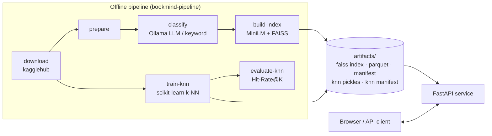
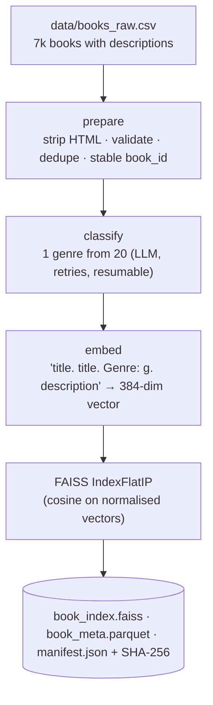
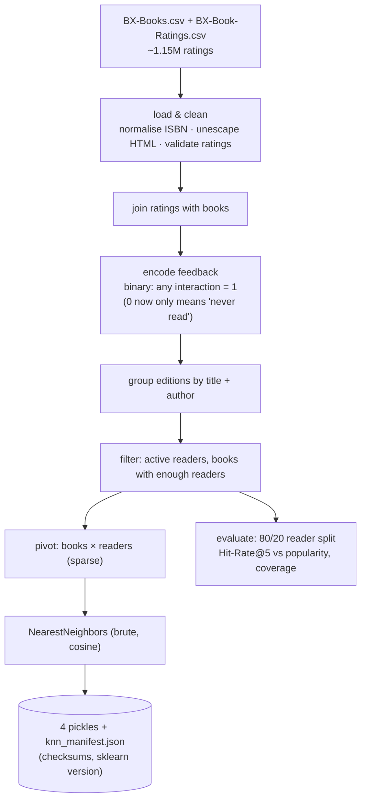
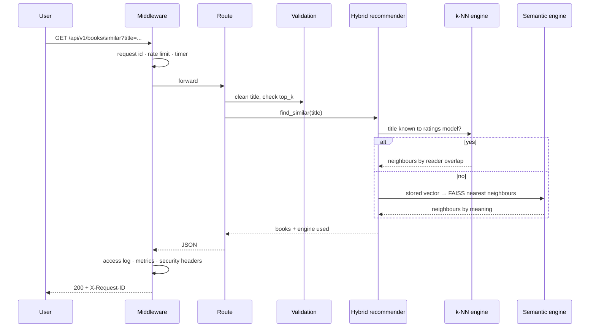
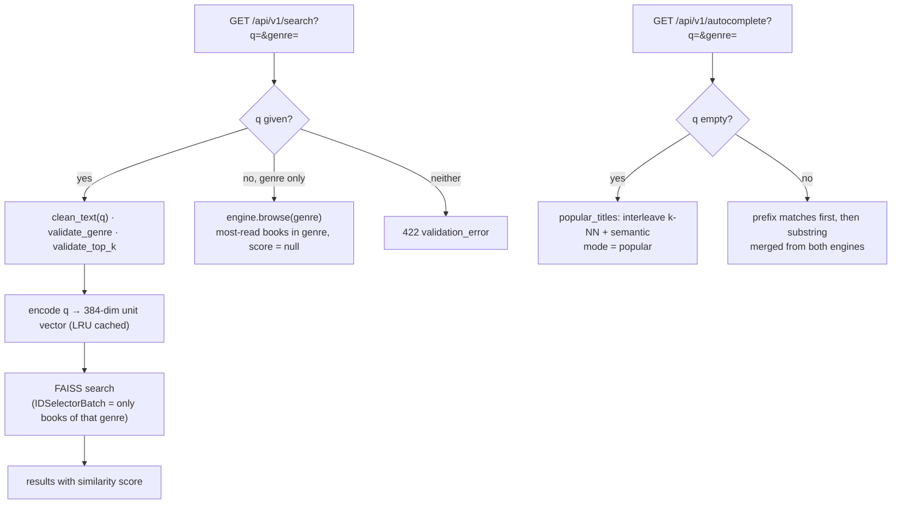
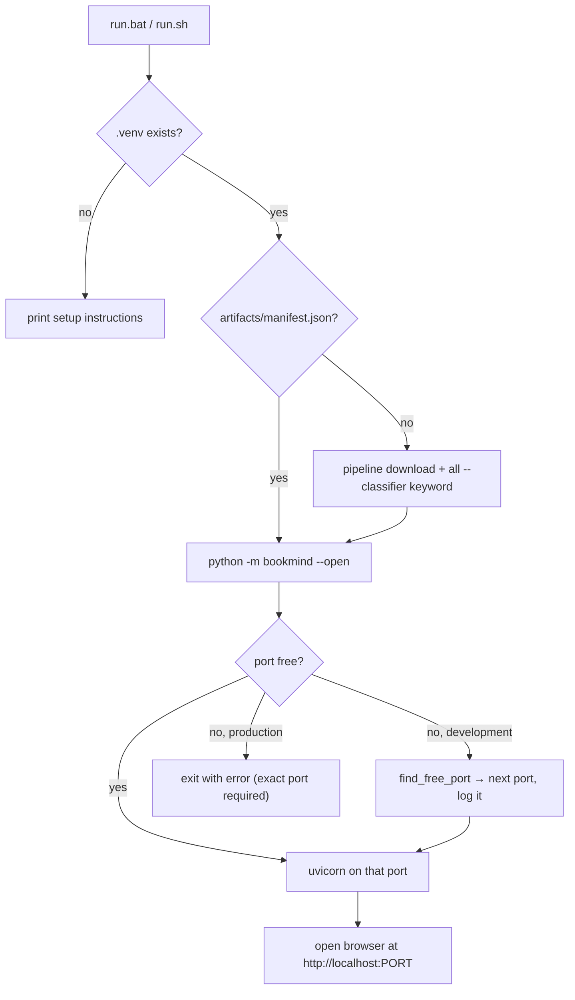
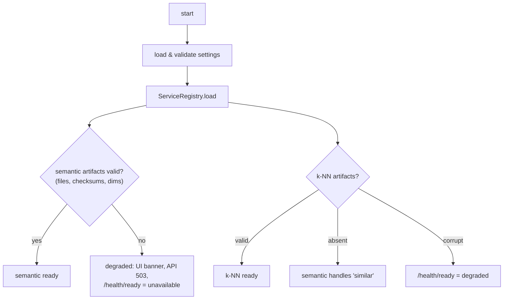
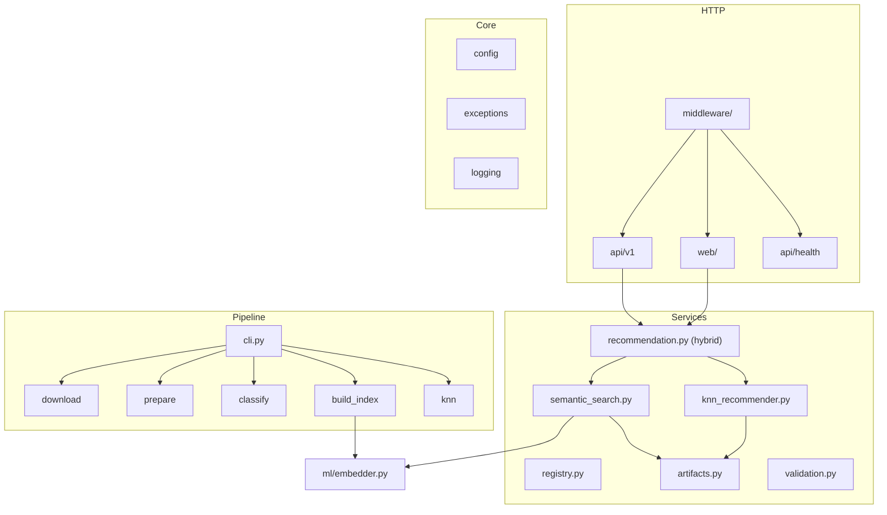

# BookMind Pro — Architecture

## 1. System overview

## 2. Semantic pipeline (content-based)

## 3. Collaborative-filtering pipeline

## 4. Request lifecycle

## 5. Search, browse & autocomplete (discovery)

## 6. Launcher (`run.bat` / `python -m bookmind`)

## 7. Startup & resilience

## 8. Code layers

| Layer | Responsibility |
|---|---|
| Core | Settings, error types, logging used everywhere |
| ML | Text → vectors (swappable model) |
| Services | Business logic, independent of the web framework |
| HTTP | Translate requests ↔ service calls; cross-cutting concerns in middleware |
| Pipeline | Heavy offline work, kept out of the request path |

## 9. Module map

| Module | Key functions / classes | Purpose |
|---|---|---|
| `__main__.py` | `port_is_free`, `find_free_port`, `main` | One-command launcher |
| `main.py` | `create_app`, `lifespan` | App factory, middleware order, routers |
| `core/config.py` | `Settings`, `get_settings`, `GENRE_TAXONOMY` | Validated configuration |
| `core/exceptions.py` | `BookMindError` + 8 subclasses | Typed errors → HTTP status + code |
| `core/logging.py` | `setup_logging`, `JsonFormatter`, `request_id_ctx` | Structured logs with request IDs |
| `middleware/request_context.py` | `RequestContextMiddleware` | Request ID, access log, metrics, security headers |
| `middleware/rate_limit.py` | `RateLimitMiddleware` | Per-IP moving-window limit, 429 envelope |
| `api/v1/routes.py` | `search`, `similar`, `autocomplete`, `genres`, `stats` | JSON API |
| `api/health.py` | `live`, `ready`, `metrics` | Probes and Prometheus |
| `api/errors.py` | `error_response`, handlers | JSON or HTML error pages |
| `web/routes.py` | `home`, `search_page`, `recommend_*`, `about` | Server-rendered pages |
| `services/semantic_search.py` | `SemanticSearchEngine` (`search`, `similar`, `browse`, `popular`, `autocomplete`) | FAISS engine |
| `services/knn_recommender.py` | `KnnRecommender` (`recommend`, `popular`, `autocomplete`) | Collaborative filtering engine |
| `services/recommendation.py` | `find_similar`, `popular_titles`, `autocomplete`, `catalogue_stats` | Hybrid logic |
| `services/registry.py` | `ServiceRegistry` | Loads engines, degraded mode |
| `services/artifacts.py` | `save_artifacts`, `load_artifacts`, `sha256_file`, `atomic_write_bytes` | Versioned, checksummed files |
| `services/validation.py` | `clean_text`, `validate_top_k`, `validate_genre` | Input validation |
| `ml/embedder.py` | `SentenceTransformerEncoder`, `HashingEncoder`, `CachedEncoder`, `l2_normalize` | Text → vectors |
| `pipeline/*.py` | `download_datasets`, `prepare_dataframe`, `run_classify`, `build_index`, `train_knn`, `evaluate_knn` | Offline pipeline |
| `static/js/*.js` | `theme.js`, `main.js`, `autocomplete.js` | Theme, navigation, type-ahead |

A function-by-function walkthrough with the reasoning behind each design choice is in
[`EXPLAINER.html`](EXPLAINER.html).
