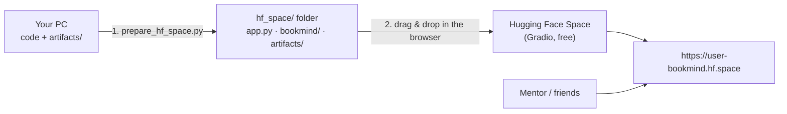
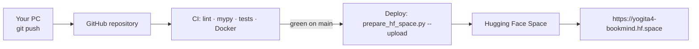

# Put BookMind online — free, 24/7, no laptop needed

**Hugging Face Spaces** hosts the app for free, like Streamlit Community Cloud does for Streamlit apps.
You get a permanent link such as `https://yourname-bookmind.hf.space` that keeps working when your
laptop is off.

> **Important (2026):** on free Hugging Face accounts, **Docker Spaces are now paid** and new free
> accounts can only pick **Gradio + ZeroGPU** hardware. So the free deployment uses a small **Gradio
> front end** (`deploy/gradio/app.py`) on top of the *same* search and recommendation engines.
> Your FastAPI website, REST API and tests are unchanged and still run locally with `run.bat`.

| | Free Gradio Space |
|---|---|
| Cost | Free, no credit card |
| What visitors see | A Gradio page with **Search**, **Recommend** and **About** tabs (light/dark automatic) |
| Engines | Same as the full app: MiniLM + FAISS semantic search, k-NN collaborative filtering, hybrid fallback |
| Always on? | Sleeps after ~48 h without visitors; the next visit wakes it (1–2 min) |
| Link | `https://<username>-bookmind.hf.space` |



**Two routes — pick one:**

| Route | Your PC uploads to | Use it when |
|---|---|---|
| **A — Browser** (Steps 1–8) | huggingface.co | Your network reaches huggingface.co reliably |
| **B — Via GitHub** ([jump](#route-b--via-github-when-your-network-blocks-huggingfaceco)) | github.com only; GitHub's servers upload to Hugging Face | Uploads to huggingface.co fail (`WinError 10054`, red **error** on `.py`/`.json` files) |

---

## Step 1 — Check the project is ready

```cmd
.venv\Scripts\activate
dir artifacts
python -m pytest
```
✅ `artifacts` has `book_index.faiss`, `book_meta.parquet`, `manifest.json`, four `.pkl` files and
`knn_manifest.json`, and the tests show `517 passed`.
No artifacts yet? `python -m bookmind.pipeline.cli download` then
`python -m bookmind.pipeline.cli all --classifier keyword`.

## Step 2 — (Optional) try the Gradio page on your PC first

```cmd
python -m pip install gradio==6.30.0
python deploy\gradio\app.py
```
Open **http://127.0.0.1:7860** — this is exactly what the Space will show. Ctrl+C to stop.

## Step 3 — Build the upload folder

```cmd
python scripts\prepare_hf_space.py
```
✅ Ends with `Ready (gradio Space): …\hf_space`. That folder has **12 files and no sub-folders**
(the browser uploader accepts them in one drop):

| Item | What it is |
|---|---|
| `app.py` | The Gradio page |
| `README.md` | Space settings (Gradio 6.30.0, Python 3.12) + description |
| `requirements.txt` | Libraries pinned to the **same versions as your PC** — the k-NN files only load with the pandas/scikit-learn they were trained with |
| `bookmind.zip` | Your search/recommendation code (`core`, `ml`, `schemas`, `services`); Python imports it straight from the zip |
| 8 artifact files | `manifest.json`, `book_index.faiss`, `book_meta.parquet`, `knn_manifest.json` and four `.pkl` files (~26 MB) |

Your `.env`, `.venv`, `data`, logs and tests are never included.

## Step 4 — Create the Space (browser)

1. Make sure your **email is verified** on Hugging Face.
2. Open **https://huggingface.co/new-space** and fill in:
   - **Space name:** `bookmind`
   - **License:** MIT (or leave empty)
   - **Select the Space SDK:** **Gradio** → template **Blank**
   - **Space hardware:** **ZeroGPU (Free)** — the default for free accounts
   - **Visibility:** **Public**
3. Click **Create Space**.

## Step 5 — Upload the files (browser)

1. On the new Space: **Files** tab → **+ Contribute** → **Upload files**.
2. In File Explorer open the `hf_space` folder, press **Ctrl+A** and **drag all 12 files** into the
   upload box.
3. Wait until all files are listed, then click **Commit changes to main**.
   If asked about `README.md`, keep **ours** (it contains the Space settings).

## Step 6 — Wait for the build (~5–10 minutes)

The badge goes **Building → Running** (click **Logs** to watch: installing libraries, then
downloading the embedding model on first start). When it's **Running** the app appears on the page.

## Step 7 — Share

| Link | Use |
|---|---|
| `https://yogita4-bookmind.hf.space` | **Share this** — the app full-screen (replace `yogita4` with your username, lower-case) |
| `https://huggingface.co/spaces/Yogita4/bookmind` | Space page (app + files + logs) |

Message you can send:
> Hi! I built BookMind, a hybrid book recommender (semantic search + collaborative filtering).
> Try it: https://yogita4-bookmind.hf.space — describe a book you'd like, pick a genre, or get
> recommendations for a book you loved. (If it's asleep, give it a minute to wake up.)

## Step 8 — Update later

Changed code or rebuilt the index → run Step 3 again → upload the changed files the same way
(Step 5). The Space rebuilds; the link stays the same.

---

## Troubleshooting

| Problem | Fix |
|---|---|
| Docker shows **Paid** / CPU Basic is greyed out | Expected on free accounts — use **Gradio + ZeroGPU** as above |
| `artifacts/ is missing …` | Build locally: `python -m bookmind.pipeline.cli all --classifier keyword` |
| `The index was built with the 'hashing' encoder` | `python -m bookmind.pipeline.cli build-index --backend sentence-transformers` |
| `WARNING: k-NN files not found` | Optional. For "readers also liked": `python -m bookmind.pipeline.cli train-knn` |
| `WARNING: … does not support Python 3.12` | Fine in most cases; if the Space then shows a k-NN error, tell us the warning |
| Space shows **Build error** | **Logs → Build**: copy the last ~30 lines and ask for help |
| Space shows **Runtime error** | **Logs → Container**: copy the last ~30 lines and ask for help |
| "Search index not loaded" on the page | The `artifacts` folder didn't upload completely — upload it again |
| Red **error** next to `.py` / `.json` files while uploading | Your network is cutting requests to huggingface.co — use **Route B (via GitHub)** or a phone hotspot |
| Space is sleeping | Open the link and wait ~1 min, or click **Restart this Space** |

## Route B — via GitHub (when your network blocks huggingface.co)

Put the **complete project** on GitHub. Two workflows then run on GitHub's servers:

| Workflow | When | What it does |
|---|---|---|
| `.github/workflows/ci.yml` (**CI**) | every push / pull request | lint (ruff), type check (mypy), all tests, dependency audit, Docker build |
| `.github/workflows/deploy.yml` (**CD**) | after CI passes on `main` | builds the Space folder and uploads it to Hugging Face |

Your PC only talks to github.com — and a broken commit never reaches your live link, because
deployment waits for green tests.



**B1 — (Recommended) record library versions in the k-NN model.** Re-train once (≈1 minute) so
`artifacts/knn_manifest.json` stores the numpy/pandas/scipy/scikit-learn versions; the deploy pins
exactly those, so the model files load the same way on the Space:
```cmd
python -m bookmind.pipeline.cli train-knn
```

**B2 — Create an empty GitHub repository** at **https://github.com/new** (Public; *don't* add a
README, .gitignore or licence — the project has them).

**B3 — Push the project** (from the project folder, with Git installed — `git --version`):
```cmd
git init
git add .
git commit -m "BookMind Pro: hybrid book recommender"
git branch -M main
git remote add origin https://github.com/<github-username>/<repository>.git
git push -u origin main
```
`git add .` respects `.gitignore`: code, docs, tests and `artifacts/` are uploaded; `.venv`, `data`,
logs, `.env` and `hf_space` are not. The first push asks you to sign in to GitHub in the browser.

**B4 — Connect GitHub to Hugging Face** (repository **Settings → Secrets and variables → Actions**)
- **Secrets** tab → **New repository secret** → Name `HF_TOKEN`, Secret = a Hugging Face **Write**
  token (huggingface.co → Settings → Access Tokens).
- **Variables** tab → **New repository variable** → Name `HF_SPACE`, Value `Yogita4/bookmind`
  (your `<hf-username>/<space-name>`).

**B5 — Run it**
Repository → **Actions**. The first CI run started with your push (≈5–10 min). The **Deploy**
workflow starts when CI is green — or start it now: **Actions → Deploy → Run workflow**.
✅ Green tick → open **https://huggingface.co/spaces/Yogita4/bookmind** → wait for **Running** →
share **https://yogita4-bookmind.hf.space**.

**From now on (CI/CD):**
```cmd
git add .
git commit -m "describe your change"
git push
```
→ tests run → if green, the Space updates automatically.

Red cross on **Deploy**? Click it and read the last lines: `HF_TOKEN secret not set` → B4;
`401`/`403` → the token isn't **Write**; `could not create the Space: 402 …` → create the Space by
hand as **Gradio + ZeroGPU** (Step 4) and re-run. Red cross on **CI**? Run
`python -m pytest` locally, fix, push again.

> Minimal alternative: `python scripts\prepare_hf_space.py --github Yogita4/bookmind` adds a
> workflow to `hf_space/` so that folder alone can be uploaded to its own small GitHub repository.

## Good to know

- **Public Space = public files.** Anyone can open the **Files** tab. That's fine here (public
  datasets, no secrets). Never upload `.env` or tokens.
- **ZeroGPU** gives the Space a GPU only on request; BookMind never asks for one (MiniLM + FAISS
  answer in milliseconds on CPU). `app.py` contains one placeholder GPU function because ZeroGPU
  Spaces must declare one at startup — it is never called.
- To take it offline: Space **Settings → Pause** (or **Delete this Space** at the bottom).

## Optional — upload from the terminal instead of the browser

Only if your network keeps the connection to huggingface.co stable:
```cmd
python -c "import getpass; from huggingface_hub import login; login(token=getpass.getpass('Token: '))"
python scripts\prepare_hf_space.py --upload <username>/bookmind
```
Use a **Write** token (Settings → Access Tokens). It is saved once per PC, outside the project.

## Full FastAPI app on Hugging Face (paid)

With a paid Hugging Face plan, Docker Spaces run the complete FastAPI app (themed pages, `/docs`,
REST API): `python scripts\prepare_hf_space.py --sdk docker`, then upload the folder to a **Docker**
Space. The image is defined in `deploy/huggingface/Dockerfile`.
