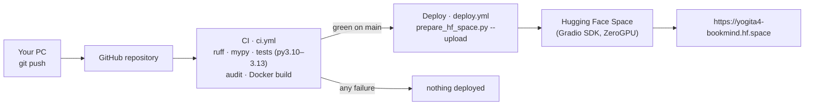

# Deployment — BookMind live on Hugging Face Spaces

**Live app:** https://yogita4-bookmind.hf.space · **Space page:** https://huggingface.co/spaces/Yogita4/bookmind
**Source & pipelines:** https://github.com/YogitaPatil5/hybrid_book_recommender

The app is hosted free on **Hugging Face Spaces** and deployed automatically by **GitHub Actions**
whenever tests pass on `main`. Visitors see the same BookMind website as `run.bat` locally (pages,
light/dark theme, dropdowns, REST API, `/docs`); a Gradio version of the screens is at `/demo`.

| | Free Hugging Face Space |
|---|---|
| Cost | Free, no credit card |
| Hardware | ZeroGPU (`zero-a10g`) — the only free option for new accounts; BookMind itself runs on CPU |
| Always on? | Sleeps after ~48 h without visitors; the next visit wakes it (~1–2 min) |
| Deploys | Automatically after green CI (or by hand — see the end of this guide) |

---

## 1. How it works



| Workflow | Runs when | What it does |
|---|---|---|
| `.github/workflows/ci.yml` (**CI**) | every push / pull request | ruff lint + format check, strict mypy, all tests on Python 3.10–3.13 with coverage, dependency audit, Docker build |
| `.github/workflows/deploy.yml` (**Deploy**) | after CI succeeds on `main` (or **Run workflow** by hand) | checks the `HF_TOKEN` secret, runs `scripts/prepare_hf_space.py --upload "$HF_SPACE"` |

`prepare_hf_space.py` builds a flat folder (`hf_space/`, 12 files) and uploads it:

| File | Contents |
|---|---|
| `app.py` | Space entry point (from `deploy/gradio/app.py`) — see section 3 |
| `README.md` | Space settings: `sdk: gradio`, `sdk_version: 6.30.0`, `python_version: "3.12"`, title, description (checked locally: valid YAML, description ≤ 60 characters) |
| `requirements.txt` | numpy, pandas, scipy, scikit-learn **pinned to the versions recorded when the k-NN model was trained** (`knn_manifest.json`), so the pickled model loads identically; other libraries pinned to the build machine or given safe ranges |
| `bookmind.zip` | The whole `bookmind` package — code, HTML templates, CSS/JS |
| 8 artifact files | `manifest.json`, `book_index.faiss`, `book_meta.parquet`, `knn_manifest.json`, four `.pkl` files (~26 MB) |

Never included: `.env`, `.venv`, `data/`, logs, tests.

---

## 2. First-time setup (already done for this project)

1. **Record library versions in the k-NN model** (so the deploy can pin them):
   `python -m bookmind.pipeline.cli train-knn`
2. **Hugging Face:** create an account, verify the email, create a **Write** token
   (avatar → Settings → Access Tokens). Optionally create the Space by hand: **New Space** →
   name `bookmind`, SDK **Gradio** (template Blank), hardware **ZeroGPU (Free)**, **Public**.
   (Docker is marked *Paid* on free accounts; CPU Basic is unavailable to new free accounts.)
3. **GitHub:** create an empty repository and push the project:
   ```cmd
   git init
   git add .
   git commit -m "BookMind Pro: hybrid book recommender"
   git branch -M main
   git remote add origin https://github.com/<github-username>/<repository>.git
   git push -u origin main
   ```
   `git add .` follows `.gitignore`: code, docs, tests and `artifacts/` are pushed; `.venv`, `data`,
   logs, `.env` and `hf_space` are not.
4. **Connect GitHub to Hugging Face** — repository **Settings → Secrets and variables → Actions**:
   - **Secrets** → `HF_TOKEN` = the Hugging Face Write token (stored encrypted, never shown in logs)
   - **Variables** → `HF_SPACE` = `Yogita4/bookmind`
5. **Actions** tab → wait for **CI** ✅ → **Deploy** ✅ → the Space goes **Building → Running**.

## 3. What `app.py` does on the Space (and why)

A Gradio Space simply runs `python app.py` and shows whatever answers on **port 7860**.

| Step | Why |
|---|---|
| Unpacks `bookmind.zip` to a temporary folder (with zip-slip protection) | Templates and static files must be real files |
| Sets production defaults: `BOOKMIND_ENV=production`, `ENABLE_DOCS=true`, `LOG_TO_FILE=false`, `FRAME_ANCESTORS=["https://huggingface.co"]`, `MOUNTED_APP_PATHS=["/demo"]` | HTTPS-only headers; `/docs` for reviewers; console logs; lets the Space page show the site in its frame; leaves Gradio's own scripts alone |
| Loads the engines once (`ServiceRegistry.load`) and builds the FastAPI app with `create_app(settings, registry=registry)` | Same code as locally |
| Mounts the Gradio screen at `/demo` with `ssr_mode=False` | Gradio's server-side rendering would start a Node.js server on port 7860 (`Errno 98 address already in use`) |
| Declares one `@spaces.GPU` placeholder and calls `spaces.zero.startup()` before starting uvicorn | ZeroGPU requires a GPU function to be reported at startup; Gradio normally does this inside `launch()`, which this app doesn't use |
| Runs uvicorn with `proxy_headers=True`, `forwarded_allow_ips="*"` | Hugging Face's proxy terminates HTTPS: links become `https://` and rate limits apply per visitor |
| Model on CPU (`BOOKMIND_EMBEDDING_DEVICE=cpu`, the default) | ZeroGPU reports a GPU that only works inside GPU functions; MiniLM is fast on CPU anyway |

## 4. Releasing a change

```cmd
python -m pytest
git add .
git commit -m "describe your change"
git push
```
CI (~6 min) → Deploy (~1 min) → Space build (~5–10 min). The link stays the same.

**Check the live status:** https://huggingface.co/api/spaces/Yogita4/bookmind/runtime shows
`"stage": "RUNNING"` (or the error) — useful when the Space page is cached.

---

## 5. Troubleshooting

| Problem | Cause → fix |
|---|---|
| **CI** red | A test, lint or type check failed — open the failed step, fix locally (`python -m pytest`), push again |
| **Deploy** skipped ⊘ | CI didn't pass — expected; fix CI first |
| `HF_TOKEN secret not set` | Add the secret (section 2, step 4), then **Re-run jobs** |
| `401` / `403` / "refused the request" | Token is Read-only or wrong, or the email isn't verified — new **Write** token, update the secret |
| `short_description … ≤ 60 characters` | Shorten it in `deploy/gradio/README.md` (the script now checks this before uploading) |
| Docker shows **Paid** / CPU Basic greyed out | Expected on free accounts — use Gradio + ZeroGPU |
| *No @spaces.GPU function detected during startup* | Old `app.py` — the current one sends the startup report |
| `[Errno 98] … ('0.0.0.0', 7860): address already in use` | Old `app.py` — the current one sets `ssr_mode=False` |
| "Search index not loaded" on the page | `artifacts/` incomplete in the repository — rebuild locally, commit, push |
| `WARNING: … version was not recorded at training time` | Run `python -m bookmind.pipeline.cli train-knn`, commit `artifacts/`, push |
| Space is sleeping | Open the link and wait ~1 minute |
| Uploads to huggingface.co fail from your PC (`WinError 10054`) | Some networks cut those connections — the GitHub route avoids it (GitHub's servers upload) |

## 6. Good to know

- **Public Space = public files.** Anyone can open the **Files** tab — fine here (public datasets,
  no secrets). Never commit `.env` or tokens.
- **Pause or remove:** Space **Settings → Pause** (or **Delete this Space**).
- **Test the Space package locally:** `python -m pip install gradio==6.30.0`, then
  `python deploy\gradio\app.py` → http://127.0.0.1:7860 (website) and `/demo` (Gradio).

## 7. Manual alternatives

**Upload by hand (browser):** `python scripts\prepare_hf_space.py` → on the Space: **Files →
Contribute → Upload files** → drag all 12 files from `hf_space\` → **Commit changes to main**.

**Upload from the terminal:** log in once with
`python -c "import getpass; from huggingface_hub import login; login(token=getpass.getpass('Token: '))"`,
then `python scripts\prepare_hf_space.py --upload <username>/bookmind`.

**Docker Space (paid plan):** `python scripts\prepare_hf_space.py --sdk docker` and upload to a
**Docker** Space (`deploy/huggingface/Dockerfile`: port 7860, user 1000, model and artifacts baked in).

**Minimal Space-only repository:** `python scripts\prepare_hf_space.py --github <username>/bookmind`
adds a workflow to `hf_space/` so that folder alone can live in its own small GitHub repository.
