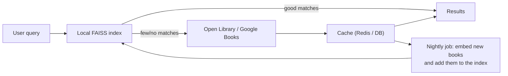

# Roadmap — scaling to larger and live book data

The current version indexes ~6.3k books (semantic) and 637 books (collaborative filtering).
The architecture was built so that the data source can change without touching the web layer:
every engine is loaded from versioned artifacts (`manifest.json`, `knn_manifest.json`), and the
pipeline's `prepare` step is the only place that knows a dataset's column names.

## 1. Bigger static datasets (next step, no code redesign)

| Dataset | Size | What it adds |
|---|---|---|
| **Goodreads (UCSD Book Graph)** | ~2.3M books, 229M interactions | Descriptions, genres, shelves, real reviews |
| **Amazon Reviews — Books** | ~3M books, ~30M reviews | Ratings + review text for both engines |
| **Open Library data dumps** | ~30M editions | Titles, authors, subjects, covers |

What changes:
- `pipeline/prepare.py`: add a column mapping for the new source (output schema stays the same).
- **Embeddings in batches** with checkpointing (already resumable for classification).
- **FAISS index type**: switch `IndexFlatIP` (exact, fine up to ~1M) to `IndexHNSWFlat` or
  `IndexIVFPQ` (approximate, milliseconds at 10M+ vectors, far less memory).
- **Metadata store**: move from a parquet file loaded in memory to PostgreSQL (or SQLite) so
  each worker doesn't hold the whole catalogue in RAM.
- **Collaborative filtering**: replace brute-force k-NN with matrix factorisation (implicit ALS /
  LightFM) or an approximate-NN index over item vectors — scales to millions of interactions.

## 2. Live data (fetch books on demand)

Free public APIs that need no paid key:

| API | Use | Limits |
|---|---|---|
| **Open Library API** (`openlibrary.org/search.json`) | Search, covers, subjects, editions | Free, no key; be polite (rate-limit, cache) |
| **Google Books API** (`googleapis.com/books/v1/volumes`) | Search, descriptions, categories, covers | Free tier ~1,000 requests/day without a key; free API key raises it |

Recommended design — **hybrid: local index first, live API as a fallback / enrichment**:

Why not call the API on every request:
- **Latency & reliability** — external APIs add 200–1000 ms and can be down; the local index
  answers in ~20 ms. The app must keep working if the API fails (same degraded-mode pattern
  already used for the engines).
- **Rate limits** — public APIs throttle; a cache plus a background job keeps you within limits.
- **Semantic search needs vectors** — new books must be embedded before they're searchable by
  meaning, so they're added to the index by a scheduled job, not mid-request.

Implementation sketch (fits the existing structure):
1. `services/live_catalog.py` — async HTTP client (`httpx`) with timeouts, retries with backoff,
   and a circuit breaker; returns the same `Book` schema.
2. Cache responses (Redis is already in `docker-compose.yml`) with a TTL.
3. `bookmind-pipeline sync-live` — fetches newly cached books, embeds them, and rebuilds or
   appends to the FAISS index (new manifest version).
4. Settings flag `BOOKMIND_LIVE_FALLBACK=true` so it can be switched on per environment.

## 3. Product features for a public release

- User accounts and saved reading lists (PostgreSQL + auth).
- Personalised "for you" feed from a user's own ratings (the collaborative model supports this).
- Feedback signals (clicks, likes) → offline evaluation and A/B tests.
- Cross-encoder re-ranking of the top results for higher precision.
- Hybrid lexical + vector search (BM25 + FAISS) for exact title/author matches.
- Monitoring dashboards on the existing Prometheus `/metrics` endpoint (Grafana) and alerts.
- Kubernetes deployment with horizontal autoscaling (the app is already stateless with
  health/readiness probes).
